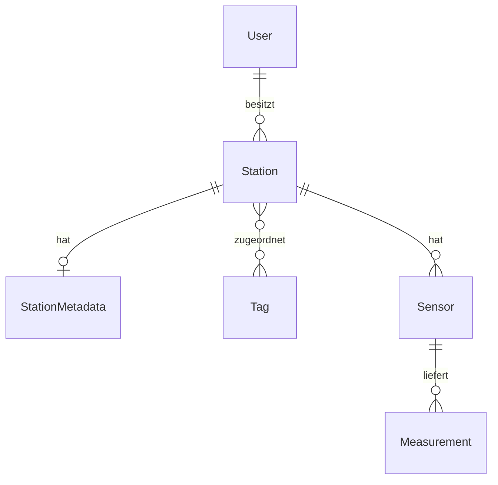

# Fortgeschrittener Django-Workshop: Monitoring

Ausgangsprojekt für den zweitägigen Workshop.
Python 3.14, Django 5.2, Django REST Framework und PostgreSQL.


*Symbolbild zur Monitoring-Anwendung. Foto: [Markus McKay / Unsplash](https://unsplash.com/photos/J8qBc5ExFAA).*

## Voraussetzungen am Kursarbeitsplatz

Der Kurs findet unter Windows 11 statt. Alle Befehle verwenden PowerShell.
Die IT hat Docker mit Compose bereits eingerichtet.
Die folgende Anleitung richtet nur das Workshop-Projekt ein.


In PowerShell kurz prüfen:

```powershell
py -3.14 --version
git --version
docker compose version
docker info --format '{{.OSType}}'
```

Der letzte Befehl muss eine erreichbare Docker-Engine für Linux-Container
anzeigen (`linux`). PostgreSQL läuft im Container; Django läuft lokal unter Windows.
Bei fehlenden Befehlen oder einer nicht erreichbaren Engine zuerst die
bereitgestellte Umgebung beziehungsweise die IT prüfen.

## Projekt bereitstellen

Falls das Repository noch nicht lokal vorliegt, in einem eigenen Arbeitsordner:

```powershell
git clone --branch livecode https://github.com/pietow/django-advanced-monitoring.git
```

Bei einem vorhandenen Checkout eigene Änderungen sichern und im Projektordner
auf den Branch `livecode` wechseln:

```powershell
git fetch origin
git switch livecode
```

Der Workshop beginnt auf dem Branch `livecode`. `clone` und `git fetch` laden auch
den Branch `main` und alle Kursstände (Tags) herunter. Bei Bedarf wechselt
`git switch main` auf `main`.

## Projektumgebung einrichten

Im Projektordner:

```powershell
py -3.14 -m venv .venv
.\.venv\Scripts\Activate.ps1
python -m pip install -r requirements.txt
if (-not (Test-Path .env)) { Copy-Item .env.example .env }
```

Die Aktivierung in jedem neuen Terminal wiederholen. Im Editor den Interpreter
`.venv\Scripts\python.exe` für das Projekt auswählen.


Die Konfiguration liegt in `.env`. Die Vorlage enthält Werte für den lokalen
Workshop. Eine vorhandene `.env` beim erneuten Setup beibehalten.
Django und Docker Compose laden diese Datei automatisch. Bereits gesetzte
Umgebungsvariablen in der Shell haben Vorrang. Fehlende oder leere Pflichtwerte
führen zu einem Fehler; in den Einstellungen gibt es keine Ersatzwerte.
Die lokale `.env` ist von Git ausgeschlossen.

`DJANGO_DEBUG` verwendet `1` oder `0`, `DJANGO_ALLOWED_HOSTS` eine durch Kommas
getrennte Liste. Für die Demo-Daten muss `DJANGO_DEBUG=1` gesetzt sein.
Zugangsdaten und Schlüssel in der Vorlage sind ausschließlich für die lokale
Entwicklung vorgesehen.

## Datenbank vorbereiten und Anwendung starten

Docker muss laufen. Im Projektordner mit aktivierter virtueller Umgebung:

```powershell
docker compose up -d --wait db
python manage.py migrate
python manage.py seed_demo_data
python manage.py check
python manage.py makemigrations --check --dry-run
python manage.py runserver
```

Bei Fehlern den jeweiligen Schritt klären, bevor mit dem nächsten fortgefahren wird.
Sind Demo-Daten bereits vorhanden, beendet sich der Seeder ohne Änderungen;
ein Reset ist für den normalen Start nicht erforderlich.

Die Admin-Oberfläche ist unter <http://127.0.0.1:8000/admin/> erreichbar.
Für einen eigenen Admin-Zugang bei Bedarf in einem zweiten Terminal mit
aktivierter virtueller Umgebung `python manage.py createsuperuser` ausführen.
Im Startstand sind noch keine Workshop-API-Endpunkte eingerichtet.

Der Arbeitsplatz ist vorbereitet, wenn PostgreSQL erreichbar ist, die Checks
keine Probleme melden und der Entwicklungsserver startet. Den Server mit
**Strg+C** beenden. Mit `docker compose stop` wird PostgreSQL gestoppt; die
Daten bleiben im benannten Volume erhalten.

Weiterführende Hinweise zur bereitgestellten Windows-Umgebung:
[Windows-Version ermitteln](https://learn.microsoft.com/windows/client-management/client-tools/windows-version-search),
[Docker-Systemvoraussetzungen](https://docs.docker.com/desktop/setup/install/windows-install/#system-requirements).

## Demo-Daten

Der Seeder erzeugt einen deterministischen Datensatz für den Workshop. Er kann nur
bei `DJANGO_DEBUG=1` ausgeführt werden:

```powershell
python manage.py seed_demo_data
```

Wenn Demo-Stationen bereits vorhanden sind, bricht der Befehl ohne Änderungen ab.
Mit `--reset` werden ausschließlich Stationen mit dem reservierten `DEMO-`-Präfix
und deren abhängige Daten ersetzt; Benutzer und Tags werden nicht gelöscht:

```powershell
python manage.py seed_demo_data --reset
```

Für Abfragen und Performance-Übungen kann der Seeder etwa 1.000 Messungen pro
messendem Sensor erzeugen:

```powershell
python manage.py seed_demo_data --reset --large
```

## Struktur und Umfang

- `config/`: Einstellungen, URL-Konfiguration sowie ASGI- und WSGI-Einstiegspunkte.
- `monitoring/`: die fünf Domänenmodelle, Registrierung in der Admin-Oberfläche,
  initiale Migration.
- `compose.yaml`: lokaler PostgreSQL-Dienst.

## Fachliche Übersicht

Eine `Station` ist eine Messstation mit Standort und Besitzer (`User`).
`StationMetadata` ergänzt optionale Angaben wie Höhe, Betreiber und Installationsdatum.
Ein `Sensor` gehört zu einer Station und erfasst Messwerte (`Measurement`) mit
Zeitstempel und Qualitätskennzeichnung. `Tag` dient zur Einordnung von Stationen.



| Modell | Beziehung | Zielmodell | Django-Feld |
| --- | --- | --- | --- |
| `Station` | N:1 | `User` | `ForeignKey` |
| `StationMetadata` | 1:1 | `Station` | `OneToOneField` |
| `Station` | M:N | `Tag` | `ManyToManyField` |
| `Sensor` | N:1 | `Station` | `ForeignKey` |
| `Measurement` | N:1 | `Sensor` | `ForeignKey` |

Django setzt die M:N-Beziehung zwischen Station und Tag über eine automatisch angelegte Zwischentabelle um.
